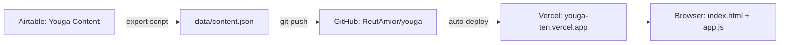
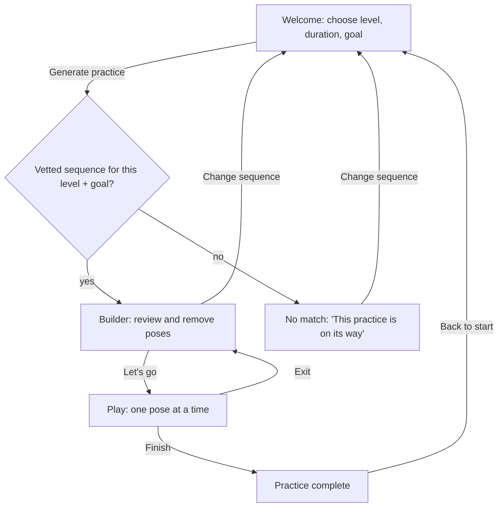
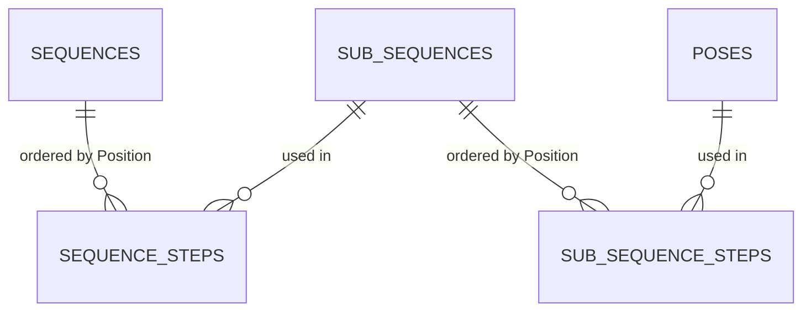

# Youga — UI and technical architecture

Internal reference for how Youga is built: its screens, its components, and how content gets from Airtable to the user. Update it in the same change as the code it describes.

- **Last updated:** 2026-11-03
- **Shared copy:** a Claude doc with the same content (https://claude.ai/artifact/PPQpgzZDW8BSk8PkU79nrm). This file is the source of truth; update both together.
- **Live app:** https://youga-ten.vercel.app/
- **Component gallery:** `styleguide.html` (open it from the deployed site at `/styleguide.html`)
- **Decisions:** `decisions/` (the *why*; this doc is the *what* and *how*)

## 1. At a glance

Youga is a static web app (HTML, CSS and plain JavaScript, no framework or build step) hosted on Vercel. Practice content is written in Airtable, exported to `data/content.json`, and committed to this repo. The browser only ever reads that JSON file, so no Airtable key reaches users. User accounts and saved data (Supabase, decision 004) are not built yet.



## 2. User flow



All screens live in one page (`index.html`); `app.js` shows one `<section>` at a time.

## 3. Screens

### 3.1 Welcome (`#welcome`)
- **Purpose:** the user says what they want to practice today.
- **Contents:** eyebrow "Personal practice generator", large two-tone logo, tagline "Yoga, Your Way.", intro line, a form card with three choices, the **Generate practice** button, footer.
- **Choices** (must match the Airtable option names exactly):

| Field | Options | Airtable field |
|---|---|---|
| Experience level | Beginner, Intermediate, Advanced | Sequences → Level |
| Practice duration | 15, 30, 45 minutes (default 45) | Sequences → Length (minutes) |
| Goal | Energize, Relax, Stretch, Relieve pain | Sequences → Goal |

- **Error state:** if `data/content.json` can't load, a line under the button asks the user to refresh.

### 3.2 Builder (`#builder`)
- **Purpose:** review the generated practice and remove poses you don't want. This merges the old "Your practice" list with the sequence review page.
- **Contents:**
  - small logo, sequence name, chips for minutes, level and goal
  - a note when the length is a closest match ("We don't have a 15-minute version yet, so here is the 45-minute one.")
  - one **section heading** per sub-sequence, in Sequence steps order, with its pose count
  - a two-column grid of **builder pose cards** under each heading
  - **empty state** "No poses yet" for a sub-sequence with no steps in Airtable
  - **empty state** "You removed all poses from this part" when the user removes every pose in a sub-sequence
  - the 3-pose minimum note when it applies
  - **action bar:** Change sequence · Let's go
  - **toast** with Undo after a removal
- **Rules:**
  - The "×" appears only on poses in sub-sequences where **Editable = Yes**.
  - A practice can't drop below **3 poses** (`MIN_POSES` in app.js). At the minimum, every "×" greys out and the note appears.
  - **Undo** restores the most recent removal to its original place. The toast stays for **6 seconds** (`UNDO_SECONDS`).
  - Removals live only in memory. Change sequence or a page refresh resets them.

### 3.3 No match (`#no-match`)
- **Purpose:** an honest answer when no vetted sequence exists yet for the chosen level and goal.
- **Contents:** heading "This practice is on its way", which practices are available now, and **Change sequence**.

### 3.4 Play (`#play`)
- **Purpose:** guide the practice one pose at a time, so nobody has to time themselves (roadmap Phase 1).
- **Contents:** small logo and **Exit**, progress bar, sub-sequence name and "4 of 13", the **play pose card**, and the action bar **Previous · Next pose** (**Finish** on the last pose).
- **Play pose card:** picture, English name, Sanskrit name, large **breath badge**, "Into the pose" cue, "Out of the pose" cue, and "Moving to the next pose" when the step has a transition cue. A missing cue shows "Cue coming soon".
- **Rules:** plays only the poses left after removals; skips empty sub-sequences; the arrow keys move between poses; Exit returns to the builder with the removals kept.
- **Done state:** "Practice complete · Namaste" with **Back to start**.
- **Not built yet:** timed auto-advance, voice cues from the cue text, chimes or music (roadmap decisions).

## 4. Components

Every component is drawn in `styleguide.html` with the live stylesheet, so you can see them all together. In `style.css` each one has its own commented block, and colors come from the tokens at the top.

### 4.1 Design tokens

| Token | Value | Used for |
|---|---|---|
| `--terra` | #d9775b | "You" in the logo, primary buttons |
| `--terra-dark` | #b95e44 | primary hover, Exhale text |
| `--sage` | #5e8f86 | "ga" in the logo, eyebrow, progress, breath counts |
| `--sky` | #3e7e90 | Inhale |
| `--ink` | #3b3340 | text, toast background |
| `--muted` | #7a7178 | secondary text |
| `--bg` / `--surface` / `--sand` / `--line` | #fbf8f3 / #fff / #f3ece1 / #ece5da | page, cards, soft fills, borders |

Type: **Fraunces** (headings, Sanskrit names, logo) and **Inter** (everything else), from Google Fonts.

### 4.2 Inventory

| Component | Class | Where | Behavior |
|---|---|---|---|
| Logo | `.logo`, `.logo-small` | every screen | "You" terracotta, "ga" sage |
| Primary button | `.btn .btn-primary` | Generate practice, Let's go, Next pose / Finish | one per screen |
| Secondary button | `.btn .btn-secondary` | Change sequence, Previous, Back to start | Previous is disabled on the first pose |
| Text button | `.btn-text` | Exit (Play) | low emphasis |
| Remove button | `.btn-icon` | builder pose cards in editable sub-sequences | greys out (`aria-disabled`) at the 3-pose minimum |
| Action bar | `.action-bar` | Builder, Play | fixed bottom; secondary left, primary right |
| Chip | `.chip`, `.chip-sage` | Builder header | minutes, level (sage), goal |
| Breath badge | `.breath` + `-inhale` / `-exhale` / `-count`, `.breath-lg` | pose cards, play card | see 5.4 |
| Section heading | `.section-head` | Builder | sub-sequence name + count |
| Builder pose card | `.pose-card` in `.pose-grid` | Builder | picture, names, breath, optional "×" |
| Play pose card | `.play-card` | Play | picture, names, breath, cues, transition |
| Pose picture | `.pose-art`, `.pose-placeholder` | both cards | placeholder "Picture coming soon" when no image |
| Empty state | `.empty` | Builder | no poses yet / all removed |
| Toast | `.toast` | Builder | "Removed X · Undo", 6 s |
| Progress | `.progress` | Play | fills with each pose |
| Form card | `.form-card`, `select` | Welcome | three choices |

### 4.3 Button labels by screen

| Screen | Left (secondary) | Right (primary) | Other |
|---|---|---|---|
| Welcome | — | Generate practice | |
| Builder | Change sequence | Let's go | "×" on editable poses, Undo in the toast |
| No match | Change sequence | — | |
| Play | Previous | Next pose / Finish | Exit (top right) |
| Done | Back to start | — | |

## 5. Content and data

### 5.1 Airtable base: Youga Content (`appNSNsHW04fBNxLc`)

| Table | One row is | Key fields |
|---|---|---|
| **Poses** | a pose | Pose name, Sanskrit name, Picture, Level, Contraindications, Cue into pose, Cue out of pose, Default hold (breaths), Vetted, Notes, Source |
| **Sub-sequences** | a reusable mini-flow | Sub-sequence name, Goals, Level, **Editable** (Yes/No), Vetted, Notes |
| **Sub-sequence steps** | one pose inside a sub-sequence | Step (formula label), Sub-sequence, **Position**, Pose, Hold (breaths), **Breath** (Inhale/Exhale), Transition cue to next pose |
| **Sequences** | a full practice | Sequence name, Goal, Level, Length (minutes), **Vetted**, Notes |
| **Sequence steps** | one sub-sequence inside a sequence | Step (formula label), Sequence, **Position**, Sub-sequence, Transition cue to next sub-sequence |



Order always comes from **Position**, never from the order rows were linked. The Step columns are formulas that only label rows.

### 5.2 Export: Airtable → `data/content.json`
- **Script:** `scripts/export-airtable.mjs`. Run `AIRTABLE_TOKEN=pat_xxx node scripts/export-airtable.mjs` (Node 18+, token with `data.records:read` on the base). Until that's set up, Claude refreshes the file through the Airtable connector.
- **What's exported:** only sequences with **Vetted** ticked, their sub-sequences in order (empty ones included), their steps, and the poses those steps use.
- **Images:** a pose gets a picture when `images/poses/<pose-name-slug>.svg` exists (for example `mountain-pose.svg`). Airtable's Picture field isn't used by the app, because Airtable attachment links expire after a few hours.
- **The file is generated.** Edit Airtable, then re-export. Never edit the JSON by hand.

Shape of `data/content.json`:

```json
{
  "exportedAt": "2026-11-03",
  "sequences": [{
    "id": "rec…", "name": "Classic beginner class", "level": "Beginner", "goal": "Energize", "minutes": 45,
    "sections": [{
      "id": "rec…", "name": "Wind down", "editable": true, "transition": null,
      "steps": [{ "pose": "rec…", "hold": 5, "breath": null, "transition": null }]
    }]
  }],
  "poses": { "rec…": { "name": "…", "sanskrit": "…", "cueIn": "…", "cueOut": "…", "image": "images/poses/….svg" } }
}
```

### 5.3 Matching a sequence (`findSequence` in app.js)
1. Look only at vetted sequences with the chosen **level and goal**.
2. If one has the chosen **length**, use it.
3. Otherwise use the one with the closest length, and show the closest-match note.
4. If none has that level and goal, show the No match screen.

### 5.4 Breath badge
| Step has | Badge |
|---|---|
| Breath = Inhale or Exhale, Hold 1 | "Inhale" / "Exhale" |
| Breath set, Hold > 1 | "Exhale · 5 breaths" |
| No Breath | "5 breaths" (Hold, default 1) |

## 6. Files

| File | What it holds |
|---|---|
| `index.html` | every screen, action bars, toast |
| `style.css` | tokens and components (sections 1–5 inside the file) |
| `app.js` | loading, matching, builder, undo, play |
| `data/content.json` | exported content (generated) |
| `images/poses/*.svg` | pose illustrations, named by pose-name slug |
| `scripts/export-airtable.mjs` | the Airtable export |
| `styleguide.html` | component gallery |
| `docs/architecture.md` | this document |
| `decisions/` | decision records |

## 7. How this relates to the decisions

- **004 (Supabase)** and **005 (pose library in Supabase):** still the plan for user accounts, history and the phase 2 pose library. Content is authored in Airtable and shipped as JSON, per **008** (Accepted 2026-11-03).
- **006 (Vercel):** unchanged. Every push to main deploys, so use a branch and check its preview link first.
- **007 (images):** the image slot and placeholder are kept. Three illustrations exist (Mountain Pose, Upward Salute, Downward-Facing Dog beginner); the style is still being reviewed.

## 8. Known gaps and content checks (as of 2026-11-03)

- **Only one vetted sequence** (Classic beginner class: Beginner · 45 min · Energize). Every other choice shows No match, and 15 or 30 minutes falls back to the 45-minute class.
- **Three empty sub-sequences** in that class: Standing series, Seating Series, Reclined poses. It plays 14 poses, far less than 45 minutes.
- **Pictures:** 3 of 49 poses have one.
- **Changes from the previous live version:** the goal options changed (Relaxation, Flexibility, Strength, Energy became Energize, Relax, Stretch, Relieve pain); pose time is in breaths instead of minutes; the "Savasana can't be removed" rule is replaced by Editable sub-sequences; `poses.js` is gone.

### Open content issues
- [ ] **Missing cues:** Happy baby has no cue in or out; Warrior 1 has no cues and no default hold.
- [ ] **Vetting:** only 3 of 49 poses are ticked Vetted (Upward-facing dog, Downward-Facing Dog, Warrior 2). The export doesn't filter by pose Vetted yet.

## 9. Open questions
- Should 15- and 30-minute choices fall back to a longer class, or show No match?
- When does Play get timing, voice cues and chimes?
- Should the export filter out poses that aren't Vetted?
