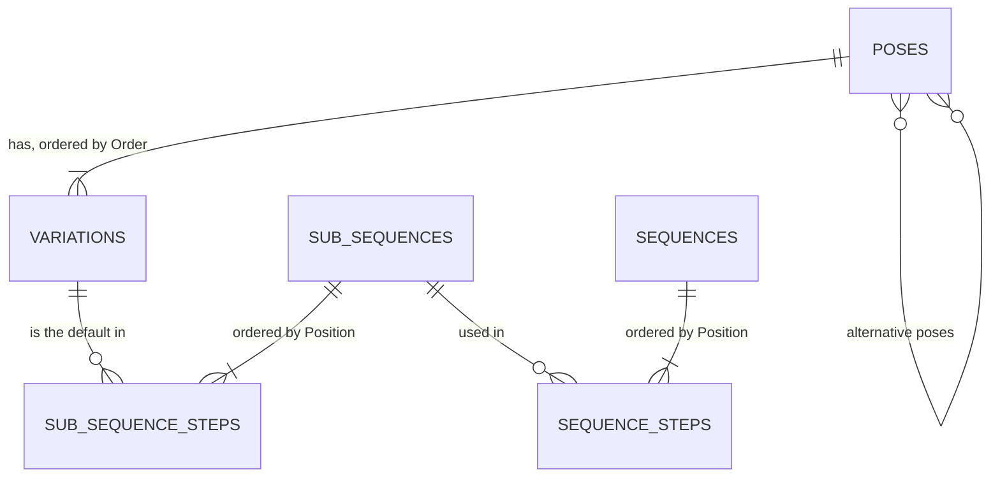

# Draft: pose variations in Airtable

- **Status:** Migration run on **Youga Content (Copy)** (`appXMpKy4TpNPp86j`) on 2026-11-18, steps 1–6. Step 7 (export and app) done 2026-11-19. That base is now the main one; the original (`appNSNsHW04fBNxLc`) is a backup. Implements [decision 009](../decisions/009-pose-variations.md).
- **Date:** 2026-11-18 (updated with your answers)

## 1. The idea in one picture

Reading it top to bottom: **Sequence → Sequence steps → Sub-sequence → Sub-sequence steps → Default variation → Pose → all its variations.**

## 2. Why a step links to a variation, not to a pose
A step needs to answer two questions: *which pose goes here?* and *which version do I show by default?*
- If the step links to a **variation**, both answers come from one link. The pose is a lookup, so it can never disagree.
- If the step linked to a **pose** plus a separate default variation, the two links could disagree (Pose = Pigeon, default = a Lizard variation). Airtable won't stop that on its own.

**So where is the Poses table used?** It's the "family" level that everything about *choosing between versions* depends on:

| Used for | How |
|---|---|
| **Swap a pose** | From the step's default variation, go to its pose, then list *all* that pose's variations by Order |
| **Stepping down a level** | Same path: find the hardest variation of this pose at or below the student's level |
| **"My version"** | Saved per **pose**, so a student's strap choice applies in every sequence that uses this pose |
| **Alternative poses** | When no variation is safe, go to the pose's alternatives |
| **Shared info** | Sanskrit name (and later body areas) live once, not on every variation |
| **Your authoring view** | Open a pose and see all its versions together, in order |

**Authoring tip:** name variations "Pose · version", for example "Extended Hand-to-Big-Toe, forward · Strap". When you pick a step's default variation, typing the pose name shows all its versions together, so you're effectively choosing by family.

## 3. Full mapping of tables and fields
**New** = add · **Rename** = same field, new name · **Move** = goes to another table · **Keep** = unchanged

### Sequences (a full practice) — unchanged structure
| Field | Type | Status | Purpose |
|---|---|---|---|
| Sequence name | text | Keep | |
| Goal | single select | Keep | Matches the Welcome form |
| Level | single select | Keep, **new meaning** | How demanding the *flow* is (pace, holds, number of poses, transitions) |
| Length (minutes) | number | Keep | |
| Vetted | checkbox | Keep | Only vetted sequences are exported |
| Notes | long text | Keep | |
| Sequence steps | link → Sequence steps | Keep | |

### Sequence steps (a sub-sequence inside a sequence) — unchanged
| Field | Type | Status | Purpose |
|---|---|---|---|
| Step | formula | Keep | Label only |
| Sequence | link → Sequences | Keep | |
| Position | number | Keep | Order |
| Sub-sequence | link → Sub-sequences | Keep | |
| Transition cue to next sub-sequence | long text | Keep | |

### Sub-sequences (a reusable mini-flow) — unchanged
| Field | Type | Status | Purpose |
|---|---|---|---|
| Sub-sequence name | text | Keep | |
| Goals | multiple select | Keep | |
| Level | single select | Keep | How demanding this flow is |
| Editable | single select | Keep | No = poses can't be removed; they **can** be swapped for a variation that fits the flow |
| Vetted, Notes | — | Keep | |
| Sub-sequence steps, Sequence steps | links | Keep | |

### Sub-sequence steps (one pose inside a sub-sequence) — one rename, one new lookup
| Field | Type | Status | Purpose |
|---|---|---|---|
| Step | formula | Keep | Label only |
| Sub-sequence | link → Sub-sequences | Keep | |
| Position | number | Keep | Order |
| **Default variation** | link → Variations | **Rename** from *Pose* | The version you'd cue in class. Existing links stay correct. |
| **Pose** | lookup (Default variation → Pose) | **New** | Read-only; shows the family |
| Hold (breaths) | number | Keep | |
| Breath | single select | Keep | |
| Transition cue to next pose | long text | Keep | |

### Variations (one way to do a pose) — today's Poses table, renamed
| Field | Type | Status | Purpose |
|---|---|---|---|
| **Variation name** | text | **Rename** from *Pose name* | "Pose · version" |
| **Pose** | link → Poses | **New** | Which family it belongs to (exactly one) |
| Level | single select B/I/A | Keep, **new meaning** | Difficulty of *this version* |
| **Order** | number | **New** | 1 = easiest within the pose; sets the swap list order |
| **Props** | multiple select | **New** | Strap, Block, Wall, Chair, Bolster, Blanket |
| **Fits the flow** | checkbox | **New** | Starts and ends in the same position as the pose's other flow versions, so it can be swapped in a protected sub-sequence |
| Contraindications | multiple select | Keep | Per version |
| Cue into pose, Cue out of pose | long text | Keep | Per version |
| Picture | attachment | Keep | Per version |
| Default hold (breaths) | number | Keep | |
| Vetted, Notes, Source | — | Keep | |
| Sanskrit name | text | **Move** → Poses | Shared by all versions |
| Sub-sequence steps | link | Keep | Reverse of *Default variation* |

### Poses (the family) — new table
| Field | Type | Status | Purpose |
|---|---|---|---|
| Pose name | text | **New** | e.g. "Extended Hand-to-Big-Toe, forward" |
| Sanskrit name | text | **Moved** from Variations | |
| Variations | link → Variations | **New** (reverse link) | All versions |
| Alternative poses | link → Poses | **New** | Used only when no variation is safe |
| Body areas | multiple select | **New**, optional | For personalization later |
| Notes | long text | **New** | |

## 4. Worked example
**Sub-sequence step:** Standing balance, Position 3, Default variation = *Extended Hand-to-Big-Toe, forward · Strap*

**Pose:** Extended Hand-to-Big-Toe, forward. Its variations:

| Order | Variation | Level | Props | Fits the flow |
|---|---|---|---|---|
| 1 | · Knee | Beginner | — | ✓ |
| 2 | · Strap | Intermediate | Strap | ✓ |
| 3 | · Full (hold the big toe) | Advanced | — | ✓ |

- **Beginner student:** the default (Strap, Intermediate) is above their level, so they get *Knee*.
- **Intermediate student:** gets the default, *Strap*.
- **Advanced student:** also gets *Strap*, because that's your default and the app never steps up on its own. *Full* (Advanced) is right there in the swap list. If you want Advanced students to get *Full* automatically, put it in an Advanced sub-sequence with *Full* as the default.
- **Advanced student who saved "my version" = Knee:** gets *Knee* here and in every other sequence with this pose.

## 5. Migration steps (in this order)
1. Rename table *Poses* → **Variations**, and field *Pose name* → **Variation name**.
2. Add **Order**, **Props** and **Fits the flow** to Variations.
3. Create the **Poses** table, one row per family (section 6).
4. Add the **Pose** link on Variations and fill it in. Every variation gets exactly one pose.
5. Move **Sanskrit name** to Poses, then delete it from Variations.
6. In Sub-sequence steps, rename *Pose* → **Default variation**, and add the **Pose** lookup.
7. Update `scripts/export-airtable.mjs` and `app.js`. **The export reads tables and fields by name**, so after steps 1, 5 and 6 it breaks until it's updated. Don't export in between. The live app keeps working, because it reads the `content.json` already in the repo.

Try it on a copy of the base first ("Duplicate base").

## 6. Groupings (confirmed 2026-11-18 unless marked)
Most of today's rows become a pose with a single variation. These are grouped:

| Pose (family) | Variations, in Order | Level | Fits the flow |
|---|---|---|---|
| Extended Hand-to-Big-Toe, forward | 1 Knee (*first variation*) · 2 Strap (*second variation*) · 3 Full (*forward*) | B · I · A | ✓ · ✓ · ✓ |
| Extended Hand-to-Big-Toe, side | 1 side | I | ✓ |
| Four-Limbed Staff | 1 Plank hold (**new row**) · 2 Four-Limbed Staff | B · I | ✓ · ✓ |
| Plank | 1 Plank on Knees · 2 Plank | B · B | ✓ · ✓ |
| Wide-Legged Forward Fold A | 1 hands on blocks · 2 hands on floor | B · B | ✓ · ✓ |
| Wide-Legged Forward Fold B | 1 hands on hips (**new row**) | B | ✓ |
| Wide-Legged Forward Fold C | 1 grasp the elbows (**new row**) · 2 hands clasped | B · I | ✓ · ✓ |
| Wide-Legged Forward Fold D | 1 hold the big toes (**new row**) | I | ✓ |
| Pyramid | 1 Pyramid · 2 elbows clasped | I · I | ✓ · ✓ |
| Bridge | 1 Supported Bridge · 2 Bridge | B · B | ✓ · ✓ |
| Fish | 1 Supported Fish · 2 Fish | I · I | ✓ · ✓ |
| Boat | 1 Half Boat · 2 Boat | B · I | ✓ · ✓ |
| Lizard | 1 Lizard Pose · 2 with Quad Stretch | I · A | ✓ · ✓ |
| Pigeon | 1 Pigeon Pose · 2 King Pigeon Prep | I · A | ✓ · ✓ |

- **Child's Pose and Extended Child's Pose** are two separate poses (confirmed).
- **Plank needs two rows.** *Plank* is used on its own in "Strength · Intermediate · Part 1", and a variation belongs to exactly one pose. So keep *Plank* under the Plank pose, and add a new row, *Four-Limbed Staff · Plank hold*, under Four-Limbed Staff, with Fits the flow ✓ and the cues for holding Plank inside a sun salutation.

**Alternative poses:**

| Pose | Alternative |
|---|---|
| Shoulder Stand | Legs Up the Wall |
| Headstand | Dolphin |
| Splits | Half Splits |

**Sun salutations:** done 2026-11-18. The sub-sequence that used Half Sun Salutation was edited, and the Sun Salutation A, B and Half Sun Salutation rows were deleted.

## 7. Migration result on the copy (2026-11-18)
- **Variations** (renamed from Poses): 100 rows. That's the 96 existing rows plus 4 new ones (Four-Limbed Staff · Plank hold, Fold B, Fold C · Grasp the elbows, Fold D), all marked "Needs cues, picture and contraindications" in Notes. Every row has a Pose and an Order. The 24 grouped variations have Fits the flow ticked.
- **Poses** (new): 88 rows, with Sanskrit names copied over. The alternatives are Shoulder Stand → Legs Up the Wall, Headstand → Dolphin, and Splits → Half Splits.
- **Sub-sequence steps:** *Pose* was renamed to *Default variation*, and a new *Pose* lookup was added. 228 of 234 steps resolve to a pose. The Step label formula still works.
- **Not done by the connector:** *Sanskrit name* is still on Variations (the connector can't delete fields), so delete it in Airtable once you're happy.
- **Found, not caused by the migration:** 6 steps have an empty pose link, in Stretch · Advanced/Intermediate Part 1, Energize · Intermediate/Advanced Part 1 and Strength · Advanced/Intermediate Part 1. They're probably where the Sun Salutation A/B rows used to be. None of them are in the vetted sequence.

## 8. What changes in the app (later, once the data is in)
- **Export:** `content.json` gets a `poses` map (family → ordered variations) and each step's `variation` ID. Variations carry level, order, props, fitsFlow and contraindications.
- **Picking:** `pickVariation(step, student)` applies the rule in decision 009. Phase 1 has no student profile yet, so it returns the default, and nothing visible changes until the level check, body check-in or swap ships.
- **Swap sheet:** a new Builder control. In protected sub-sequences, only *Fits the flow* variations are offered.
- **"My version":** saved per pose, in the browser in phase 1, then in the account in phase 2 (decision 003).
